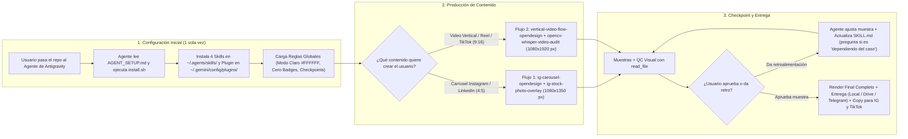
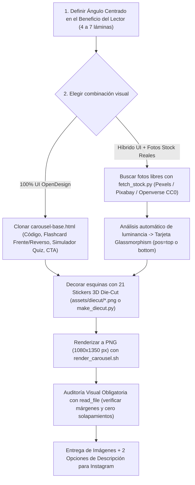
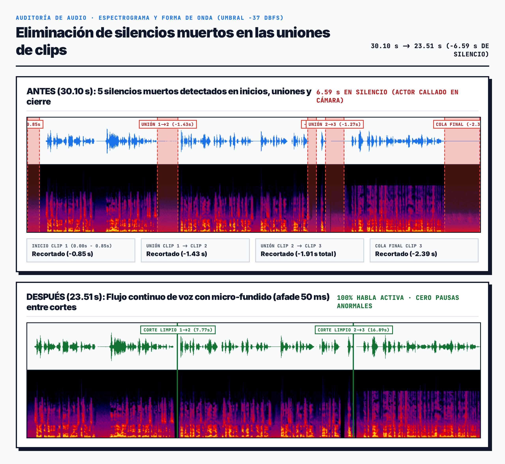
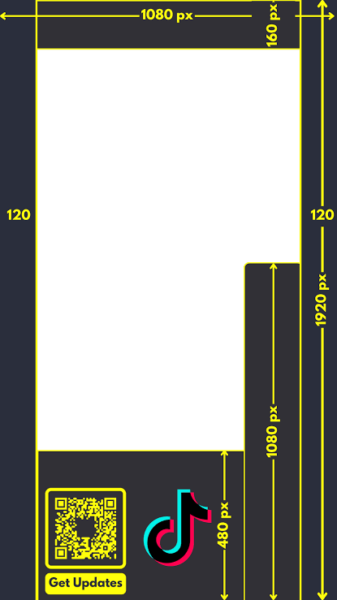
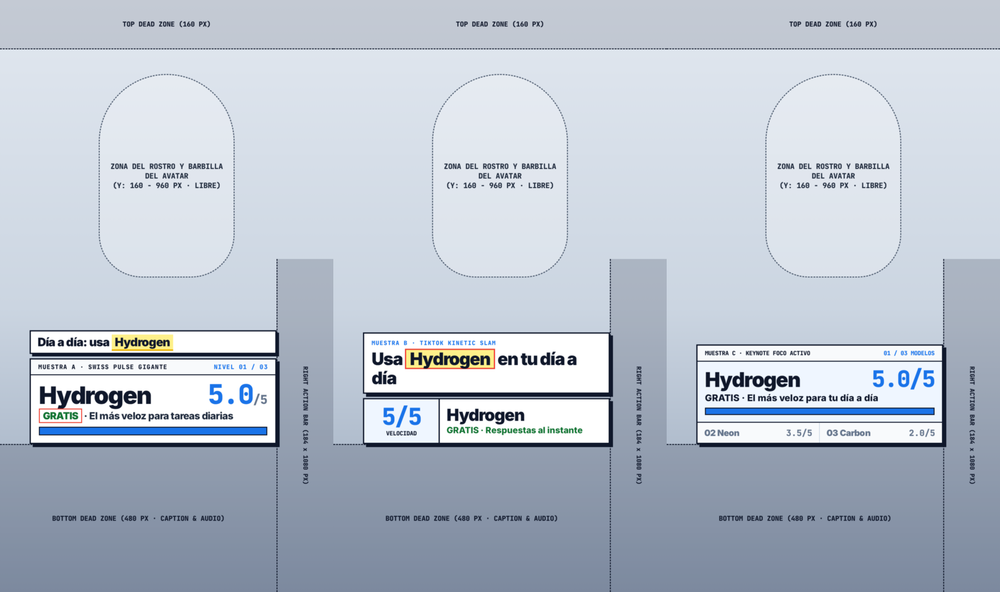
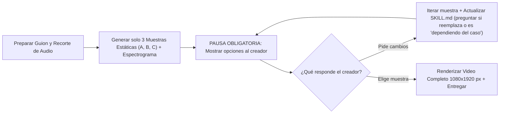

# Antigravity Content Studio · Skills y Metodología para Carruseles de Instagram y Videos Verticales (Google Flow + OpenDesign + Whisper)

Repositorio completo de **skills, plugins, plantillas HTML/CSS, scripts de auditoría de espectrograma y reglas de diseño** para producir contenido de redes sociales de calidad editorial usando tu suscripción de **Google Antigravity**:

1. **Carruseles de Instagram y LinkedIn (`1080 × 1350 px`, formato `4:5`)** con componentes UI en Modo Claro (**OpenDesign**), **21 stickers 3D troquelados (`die-cut`)** y variación con **fotografías stock gratuitas + tarjetas glassmorphism**.
2. **Videos Verticales para TikTok, Instagram Reels y YouTube Shorts (`1080 × 1920 px`, formato `9:16`)** generados con tu Avatar real y tu voz entrenada en **Google Flow** (`Ingredientes` -> `Avatares`), unidos sin silencios anormales mediante **análisis de espectrograma (`-37.0 dBFS`) + Whisper**, y vestidos con **motion graphics gigantes Mobile-First (`54px` a `88px`)** respetando estrictamente los **Safe Margins**.

---

> [!IMPORTANT]
> **¿Estás viendo este repositorio y quieres configurarlo en tu cuenta de Antigravity?**
> No necesitas configurar cada carpeta a mano. **Pásale directamente el enlace de este repositorio a tu agente de Antigravity** con el prompt de abajo y tu agente clonará el repo, instalará las skills y el plugin de Google Flow, verificará las dependencias (`ffmpeg`, `faster-whisper`, `playwright`, `Pillow`) y dejará tu entorno listo para crear contenido.

### 🤖 Prompt listo para copiar y pegar a tu Agente de Antigravity

```text
Clona y configura en mi entorno el repositorio https://github.com/danitocsc/antigravity-content-studio siguiendo todas las instrucciones de AGENT_SETUP.md y REQUIREMENTS.md. Ejecuta install.sh (o install.ps1 en Windows) para instalar las skills en ~/.agents/skills/ y el plugin antigravity-flow en ~/.gemini/config/plugins/, instala OpenMotion Studio + MCP (@openmotion/app@0.2.1) y registra el servidor MCP openmotion en ~/.gemini/config/mcp_config.json, verifica todas las dependencias (Node >= 22.18, ffmpeg, python3, Pillow, faster-whisper y playwright/agent-browser), integra las reglas de rules/AGENTS_CONTENT_RULES.md y confírmame cuando todo esté listo para empezar a crear carruseles y videos verticales.
```

---

## 📑 Índice General

1. [Cómo usar este repositorio (Para la Persona y para el Agente de IA)](#-1-cómo-usar-este-repositorio-para-la-persona-y-para-el-agente-de-ia)
2. [Todo lo que se utiliza y Requerimientos (`REQUIREMENTS.md`)](#-2-todo-lo-que-se-utiliza-inventario-completo-del-stack)
3. [Diagrama de Flujo General del Sistema](#-3-diagrama-de-flujo-general-del-sistema)
4. [Flujo 1: Carruseles de Instagram 4:5 (OpenDesign UI + Fotos Stock + Stickers 3D)](#-4-flujo-1-carruseles-de-instagram-45-opendesign-ui--fotos-stock--stickers-3d)
5. [Flujo 2: Videos Verticales 9:16 (Google Flow Avatar + Espectrograma + Safe Margins + Motion Graphics)](#-5-flujo-2-videos-verticales-916-google-flow-avatar--espectrograma--safe-margins--motion-graphics)
6. [Flujo 3: Protocolo Global de Checkpoints de Muestras y Retroalimentación](#-6-flujo-3-protocolo-global-de-checkpoints-de-muestras-y-retroalimentación)
7. [Estructura del Repositorio](#-7-estructura-del-repositorio)
8. [Prompts de Ejemplo para Crear Contenido Hoy Mismo](#-8-prompts-de-ejemplo-para-crear-contenido-hoy-mismo)

---

## 🧭 1. Cómo Usar Este Repositorio (Para la Persona y para el Agente de IA)

Este repositorio está diseñado con **doble especificación**: explica con claridad visual qué hace cada etapa para el **creador humano** y contiene instrucciones deterministas, rutas exactas y scripts ejecutables para el **agente de IA**.

### Para la Persona (Creador de Contenido)
1. **Instalación en 1 paso:** Pega en tu chat de Antigravity el prompt de la sección superior (o ejecuta `bash install.sh` en tu terminal).
2. **Prepara tu Avatar en Google Flow (solo para videos):** Entra a [flow.google.com](https://flow.google.com) con tu cuenta de Google y asegúrate de tener creado tu Avatar bajo la pestaña **`Avatares`** (por ejemplo con el nombre `Yo`).
3. **Pide tu contenido y revisa las muestras antes del render final:**
   - Cuando pidas un **carrusel**, el agente diseñará las láminas a `1080 × 1350 px`, revisará que ninguna letra se corte y te entregará los PNGs listos junto con la descripción para Instagram.
   - Cuando pidas un **video vertical de 30 segundos**, el agente generará los 3 clips de 10 s encadenando el último fotograma, recortará los silencios muertos con el espectrograma y **se detendrá en un Checkpoint para mostrarte 3 muestras visuales (`Muestra A`, `Muestra B`, `Muestra C`)**. Tú eliges cuál te gusta más y solo entonces el agente renderiza el video final completo.

### Para el Agente de IA (Antigravity)
1. **Lee primero [`AGENT_SETUP.md`](./AGENT_SETUP.md):** Contiene la secuencia exacta de instalación, verificación de binarios (`ffmpeg`, `ffprobe`, `node`, `python3`) y configuración de las reglas globales ([`rules/AGENTS_CONTENT_RULES.md`](./rules/AGENTS_CONTENT_RULES.md)).
2. **Carga la skill correspondiente según la tarea del usuario:**
   - Si el usuario pide un carrusel educativo o técnico con tarjetas UI y stickers 3D: lee [`skills/ig-carousel-opendesign/SKILL.md`](./skills/ig-carousel-opendesign/SKILL.md).
   - Si el usuario pide variar el carrusel con fotos stock reales y tarjetas translúcidas encima: lee [`skills/ig-stock-photo-overlay/SKILL.md`](./skills/ig-stock-photo-overlay/SKILL.md).
   - Si el usuario pide un reel, TikTok o short con su Avatar en Google Flow y gráficos animados: lee [`skills/vertical-video-flow-opendesign/SKILL.md`](./skills/vertical-video-flow-opendesign/SKILL.md) y [`skills/opencv-whisper-video-audit/SKILL.md`](./skills/opencv-whisper-video-audit/SKILL.md), y activa el subagente `/browser` siguiendo [`plugins/antigravity-flow/rules/AGENTS.md`](./plugins/antigravity-flow/rules/AGENTS.md).
3. **Respeta siempre las 3 restricciones innegociables:**
   - **Modo Claro obligatorio (`#FFFFFF` / `#F8FAFC`)** en todas las tarjetas, cero badges/píldoras, cero guiones largos (`—`), cero punto y coma (`;`) y cero cursivas.
   - **Checkpoint obligatorio de muestras:** Nunca renderices los 600+ fotogramas de un video sin que el usuario apruebe antes una muestra estática (`Muestra A, B o C`) y el corte del espectrograma.
   - **Actualización continua de skills ("Dependiendo del Caso"):** Cada corrección del usuario debe guardarse en el `SKILL.md` local, preguntando antes si una regla nueva reemplaza a la anterior o si ambas se conservan dependiendo del caso.

---

## 🧰 2. Todo lo que se Utiliza (Inventario Completo del Stack)

| Componente | Tipo | Ubicación / Comando | Para qué se utiliza en el flujo |
| :--- | :--- | :--- | :--- |
| **Google Antigravity + `/browser`** | Agente IA + Subagente Nativo | Chat de Antigravity (`/browser`) | Orquesta todo el flujo, controla Google Flow en el navegador y ejecuta los scripts locales de edición. |
| **Plugin `antigravity-flow`** | Plugin de Antigravity | [`plugins/antigravity-flow/`](./plugins/antigravity-flow/README.md) | Opera Google Flow (`flow.google.com`) en modo manual (`Agente de Flow` OFF), adjunta ingredientes y descarga clips en `720p`. |
| **Google Flow (`Omni 1.2 Flash`)** | Generador de Video IA | `https://flow.google.com` | Genera los clips verticales (`9:16`, `10 s`, `720p`) en modo **`Ingredientes`** usando el Avatar real (`@Yo`) + foto de referencia + último fotograma. |
| **Skill `ig-carousel-opendesign`** | Skill + Plantilla HTML + Stickers 3D | [`skills/ig-carousel-opendesign/`](./skills/ig-carousel-opendesign/SKILL.md) | Renderiza carruseles `1080 × 1350 px` en Modo Claro con `carousel-base.html` y 21 stickers 3D troquelados (`assets/diecut/*.png`). |
| **Skill `ig-stock-photo-overlay`** | Skill + Buscador de Stock API | [`skills/ig-stock-photo-overlay/`](./skills/ig-stock-photo-overlay/SKILL.md) | Descarga fotos stock libres (Pexels, Pixabay, Openverse CC0, Wikimedia) con `fetch_stock.py`, analiza luminancia y compone tarjetas glassmorphism. |
| **Skill `vertical-video-flow-opendesign`** | Skill + Plantillas Motion 9:16 | [`skills/vertical-video-flow-opendesign/`](./skills/vertical-video-flow-opendesign/SKILL.md) | Ensambla el video de 30 s, aplica Safe Margins (`1080 × 1920 px`) y renderiza las capas animadas `Swiss Pulse` y `TikTok Kinetic Slam`. |
| **Skill `opencv-whisper-video-audit`** | Skill de Auditoría de Video/Audio | [`skills/opencv-whisper-video-audit/`](./skills/opencv-whisper-video-audit/SKILL.md) | Extrae marcas de tiempo por palabra con Whisper, audita fotogramas con OpenCV y recorta silencios por espectrograma. |
| **`faster-whisper`** | Librería Python (ASR) | `pip3 install faster-whisper` | Transcribe el audio generado con `word_timestamps=True` para sincronizar cada tarjeta y barra de progreso al milisegundo con la voz. |
| **`FFmpeg` + `FFprobe`** | Motor Multimedia CLI | `ffmpeg` / `ffprobe` | Extrae el último fotograma (`-sseof -0.15`), genera espectrogramas (`showspectrumpic`) y ondas (`showwavespic`), recorta silencios con `afade` y escala a `1080 × 1920 px` (`lanczos`). |
| **`Playwright` / `agent-browser`** | Renderizador Chromium Headless | `npx playwright` / `agent-browser` | Renderiza las láminas de carrusel (`1080 × 1350 px`) y los keyframes transparentes (`omitBackground: true`) de motion graphics (`1080 × 1920 px`). |
| **`Pillow (PIL)`** | Librería Python de Imagen | `pip3 install Pillow` | Genera stickers 3D troquelados (`make_diecut.py`) y analiza el brillo/contraste de fotografías stock (`fetch_stock.py`). |
| **OpenMotion Studio + MCP (`nexu-io/openmotion`)** | Estudio de Video + 34 Herramientas MCP + 8 Skills | [`REQUIREMENTS.md`](./REQUIREMENTS.md) (`@openmotion/app@0.2.1`) | Catálogo con **300+ recetas `Motion.md`**, plantilla `presenter-tech`, Studio web local (`localhost:4173`) y clonación de efectos desde cualquier TikTok/Reel de referencia (`openmotion-recreate`). |
| **Repositorios de Motion de OpenDesign** | Referencias de Diseño Cinético | Integrados en las plantillas de `skills/vertical-video-flow-opendesign/templates/` | Patrones tomados de `heygen-com/hyperframes` (tipografía `54-88px`, `Sketchout`, `Marker Sweep`), `alchaincyf/huashu-art-motion` (*"Una pantalla, una sola cosa"*), `yangxu128/Motion.Lab` (`slam`) y `remotion-dev/remotion`. |

> Consulta la lista completa de versiones mínimas, configuración MCP (Linux, macOS y Windows) y variables opcionales en **[`REQUIREMENTS.md`](./REQUIREMENTS.md)**.

---

## 🔄 3. Diagrama de Flujo General del Sistema



---

## 🖼️ 4. Flujo 1: Carruseles de Instagram `4:5` (`1080 × 1350 px`)

Documentación completa en [`docs/WORKFLOW_CAROUSELS.md`](./docs/WORKFLOW_CAROUSELS.md).



### Características principales del flujo de carruseles
- **Modo Claro Editorial (`#F8FAFC` / `#FFFFFF`):** Bordes limpios `#0F172A`, barra superior con el espectro de 4 colores de Google, micro-navegación constante (`01 / 04`) y barra de progreso inferior segmentada.
- **21 Stickers 3D Die-Cut incluidos:** Listos en `skills/ig-carousel-opendesign/assets/diecut/` (`rocket.png`, `lightbulb.png`, `laptop_irid.png`, `gradcap.png`, `clock_gold.png`, `cursor_click.png`, etc.), más el generador `make_diecut.py` para convertir cualquier PNG transparente en sticker con borde blanco.
- **Fotografía Stock Inteligente (`fetch_stock.py`):** Descarga fotos gratuitas de uso comercial y mide automáticamente en qué mitad de la foto hay menos elementos para colocar ahí la tarjeta translúcida sin tapar rostros.

---

## 🎬 5. Flujo 2: Videos Verticales `9:16` (`1080 × 1920 px`) con Google Flow + Espectrograma + OpenDesign Motion

Documentación completa en [`docs/WORKFLOW_VERTICAL_VIDEO.md`](./docs/WORKFLOW_VERTICAL_VIDEO.md).

```mermaid
flowchart TD
    V1["1. Dividir Guion de 30 s en 3 Clips de 10 s (Gancho 0-10s, Desarrollo 10-20s, Tip/CTA 20-30s)"] --> V2["2. Google Flow en Modo Manual (Agente OFF): Video · Ingredientes · 9:16 · Omni 1.2 Flash · 720p · 10 s · x1"]
    V2 --> V3["3. Clip 1: Adjuntar Avatar @Yo (pestaña Avatares) + Foto de Referencia + DON'Ts Anatómicos (no agrandar nariz)"]
    V3 --> V4["4. Descargar Clip 1 y Extraer Último Frame Real: ffmpeg -sseof -0.15 -i clip1.mp4 -frames:v 1 clip1_last.png"]
    V4 --> V5["5. Clip 2: Adjuntar Avatar @Yo + clip1_last.png + DON'Ts -> Descargar y Extraer clip2_last.png"]
    V5 --> V6["6. Clip 3: Adjuntar Avatar @Yo + clip2_last.png + DON'Ts -> Descargar clip3.mp4"]
    V6 --> V7["7. Auditoría de Audio: faster-whisper (timestamps por palabra) + Espectrograma y RMS (-37.0 dBFS)"]
    V7 --> V8["8. Recortar Silencios Muertos en Inicios, Uniones (Clip 1->2 y 2->3) y Cola + afade 50 ms (analyze_and_trim_silences.py)"]
    V8 --> V9["9. CHECKPOINT: Enviar Lámina de Espectrograma (Antes/Después) + 3 Muestras Mobile-First (A, B, C) en Safe Margins"]
    V9 --> V10{"10. Usuario elige Muestra (ej. Muestra B TikTok Kinetic Slam)"}
    V10 --> V11["11. Renderizar Keyframes Transparentes 1080x1920 px (deduplicados por symlink) + Overlay con FFmpeg Lanczos"]
    V11 --> V12["12. QC de Mosaico de 6 Escenas con read_file -> Entrega del MP4 Final + Descripciones para Reels y TikTok"]
```



### 5.1 Corte Quirúrgico de Silencios en las Uniones por Espectrograma (`-37.0 dBFS`)
Cuando se unen 3 clips generados por IA sin recortar, el avatar se queda callado entre `1.2 s` y `2.5 s` en cada unión. El script [`analyze_and_trim_silences.py`](./skills/vertical-video-flow-opendesign/scripts/analyze_and_trim_silences.py) detecta los bordes exactos de voz activa (`-37.0 dBFS`), elimina los silencios muertos y aplica micro-fundidos (`afade` de `50 ms`):



### 5.2 Safe Margins Oficiales (`1080 × 1920 px`) y Tipografía Gigante Mobile-First (`54px` a `88px`)
En pantallas de celular, una tabla con letra de `11px–22px` no se lee y los botones de TikTok/Reels tapan los bordes. Todas las plantillas de este repositorio colocan los gráficos en la **Ventana Segura del Pecho (`left: 96px`, `right: 184px`, `bottom: 480px`, `top >= 1030px`)**, debajo de la barbilla del avatar y fuera de las zonas muertas de la interfaz:

| Diagrama Oficial de Safe Margins (`1080 × 1920 px`) | Las 3 Muestras Mobile-First dentro de la Zona Segura |
| :---: | :---: |
|  |  |

---

## 🔁 6. Flujo 3: Protocolo Global de Checkpoints de Muestras y Retroalimentación

Documentación completa en [`docs/FEEDBACK_ITERATION_PROTOCOL.md`](./docs/FEEDBACK_ITERATION_PROTOCOL.md).



---

## 📂 7. Estructura del Repositorio

```text
antigravity-content-studio/
├── README.md                                   # Esta guía principal (humana + agente IA)
├── AGENT_SETUP.md                              # Instrucciones ejecutables para que el agente configure todo
├── REQUIREMENTS.md                             # Matriz completa de dependencias, versiones, OpenMotion MCP y variables
├── install.sh                                  # Instalador automático para Linux / macOS / WSL (incluye @openmotion/app)
├── install.ps1                                 # Instalador nativo para Windows (PowerShell)
├── rules/
│   └── AGENTS_CONTENT_RULES.md                 # Reglas globales (Modo Claro #FFFFFF, Cero Badges, Checkpoints)
├── docs/
│   ├── INDEX.md                                # Índice detallado de toda la documentación
│   ├── WORKFLOW_CAROUSELS.md                   # Guía profunda de carruseles 4:5 (1080x1350)
│   ├── WORKFLOW_VERTICAL_VIDEO.md              # Guía profunda de video vertical 9:16 (1080x1920)
│   └── FEEDBACK_ITERATION_PROTOCOL.md          # Protocolo de checkpoints e iteración de skills
├── examples/
│   ├── safe-margins-1080x1920.png              # Diagrama de márgenes seguros de TikTok/Reels/Shorts
│   ├── spectrogram-before-after.png            # Ejemplo de recorte de silencios por espectrograma (-37 dBFS)
│   └── motion-samples-showcase.png             # Comparativa de las 3 variantes Mobile-First en zona segura
├── skills/
│   ├── ig-carousel-opendesign/                 # Skill de carruseles UI + 21 stickers 3D die-cut + scripts
│   ├── ig-stock-photo-overlay/                 # Skill de carruseles con fotos stock libres + glassmorphism
│   ├── vertical-video-flow-opendesign/         # Skill de video 9:16 con Flow @Yo + plantillas HTML/JS + corte RMS
│   └── opencv-whisper-video-audit/             # Skill de auditoría de video con OpenCV + Whisper + espectrograma
└── plugins/
    └── antigravity-flow/                       # Plugin para operar Google Flow con el subagente /browser
```

---

## 💬 8. Prompts de Ejemplo para Crear Contenido Hoy Mismo

Una vez que tu agente haya ejecutado la instalación, puedes pedirle cualquiera de estos tres flujos:

### Ejemplo A: Crear un Carrusel de Instagram (`1080 × 1350 px`) con OpenDesign
```text
Usa la skill ig-carousel-opendesign para crear un carrusel de 4 láminas (1080x1350 px) en Modo Claro sobre [TEMA]. Enfócalo en cómo beneficia esto a un estudiante o profesional hoy mismo, usa 1 componente UI protagonista por lámina con stickers 3D die-cut, verifica todas las imágenes generadas y dame 2 opciones de descripción para Instagram.
```

### Ejemplo B: Crear un Carrusel Híbrido con Fotografías Stock Gratuitas
```text
Combina las skills ig-stock-photo-overlay e ig-carousel-opendesign para hacer un carrusel de 4 láminas sobre [TEMA], usando una portada fotográfica stock con tarjeta glassmorphism y láminas interiores con componentes UI en Modo Claro.
```

### Ejemplo C: Crear un Video Vertical de 30 s (`1080 × 1920 px`) con tu Avatar en Google Flow y Motion Graphics
```text
/browser Usa la skill vertical-video-flow-opendesign para crear un video vertical de 30 segundos (9:16) de mi Avatar hablando sobre [TEMA / URL]. Divide el guion en 3 clips de 10 segundos usando mi Avatar en modo Ingredientes (más esta foto de referencia y los DON'Ts para respetar mis facciones), encadena el último fotograma entre cada clip, recorta los silencios en las uniones analizando el espectrograma (-37 dBFS) y muéstrame primero la lámina del espectrograma junto con 3 muestras estáticas de gráficos Mobile-First dentro de los Safe Margins para que yo elija cuál renderizar completo.
```
