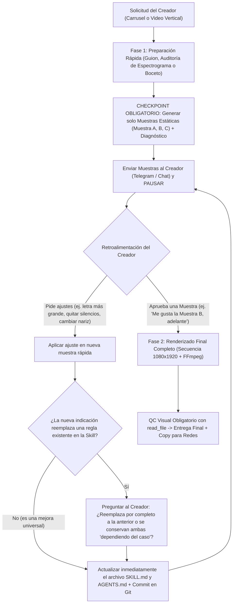

# Protocolo Global de Iteración sobre Retroalimentación y Checkpoints

Este documento define cómo debe comportarse el agente de **Google Antigravity** al colaborar con el creador de contenido para no desperdiciar tiempo de renderizado y mejorar las skills de forma permanente en cada sesión.

---

## 1. Diagrama de Flujo del Ciclo de Retroalimentación

---

## 2. Las 3 Reglas de Oro del Protocolo

### Regla 1: Checkpoint Obligatorio de Muestras antes de Renderizar
- **Por qué existe:** Renderizar 720 fotogramas en Chromium y codificar video en FFmpeg toma tiempo y CPU. Si el tamaño de fuente, el estilo gráfico o los cortes de audio aún no convencen al creador, renderizar el video completo de inmediato desperdicia tiempo.
- **Cómo se aplica:** El agente siempre genera primero **1 imagen de muestra por propuesta (`Muestra A`, `Muestra B`, `Muestra C`)** y la lámina del **Espectrograma (`Antes vs. Después`)**, las envía al creador y **espera su respuesta** antes de lanzar el renderizado completo.

### Regla 2: Iteración Inmediata de Skills sobre la Retroalimentación
- Cada corrección del creador (por ejemplo: *"la nariz salió muy grande, agrégalo a los DON'Ts"*, *"el texto es muy pequeño para celular"*, *"en la unión entre clips se queda callado, usa un espectrograma"*) no solo se corrige en el video actual, sino que se **documenta de inmediato en la skill correspondiente (`SKILL.md`)** para que nunca vuelva a ocurrir en futuros videos.

### Regla 3: Preguntar Antes de Reemplazar ("Dependiendo del Caso")
- Cuando el creador elige un estilo nuevo (por ejemplo, elegir una tarjeta de un solo foco gigante en lugar de una tabla de 3 filas), el agente **no borra a ciegas el patrón anterior**.
- Primero pregunta si el nuevo estilo debe **reemplazar por completo** al anterior o si ambos deben quedar documentados en la skill como variantes **dependiendo del caso** (por ejemplo: usar `TikTok Kinetic Slam` para Reels dinámicos en celular, y conservar la tabla de 3 filas para resúmenes estáticos o vistas de escritorio).
