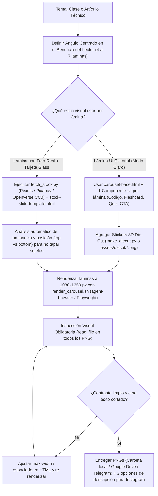

# Metodología de Carruseles de Instagram (`1080 × 1350 px` · OpenDesign + Stock Overlay)

Esta guía documenta el flujo completo para crear carruseles educativos de alta retención en formato `4:5` (`1080 × 1350 px`) combinando las skills [`ig-carousel-opendesign`](../skills/ig-carousel-opendesign/SKILL.md) e [`ig-stock-photo-overlay`](../skills/ig-stock-photo-overlay/SKILL.md).

---

## 1. Diagrama de Flujo del Pipeline de Carruseles



---

## 2. Principios Clave que Hacen que el Carrusel Funcione

1. **Enfoque en el Beneficio del Lector (No en Bitácora Personal):**
   - En lugar de contar *"lo que vi hoy en una reunión"*, traduce el tema en **cómo le ahorra tiempo, esfuerzo o errores al lector hoy mismo** (por ejemplo: *"Estudia en la mitad de tiempo. Comprende el doble"*).
2. **Estructura Compacta de 4 Láminas + Página Interactiva (o 7 Láminas para Guías Completas):**
   - **`01 / EL PROBLEMA`:** Gancho cuantificado + ventana minimalista de código en 3 líneas (`metodo.py`) + stickers 3D die-cut.
   - **`02 / HERRAMIENTA 1`:** Ejemplo real aplicado (ej. tarjeta Flashcard con Frente y Reverso reales, no explicación abstracta).
   - **`03 / HERRAMIENTA 2`:** Simulador de prueba práctica (mockup de Quiz con reactivo real, barra de progreso y respuesta comentada).
   - **`04 / PASO A PASO Y CTA`:** Llamado a la acción claro (hacia una página interactiva o recurso descargable) + pregunta abierta en la caja inferior para generar comentarios.
3. **Variación Visual con Fotografías Stock (`ig-stock-photo-overlay`):**
   - Para alternar el ritmo visual entre publicaciones, usa `scripts/fetch_stock.py` para descargar fotos gratuitas y libres de derechos (Pexels, Pixabay, Openverse CC0 o Wikimedia).
   - El script calcula la luminancia y el desorden visual (`clutter_std`) de la mitad superior e inferior de la foto y recomienda automáticamente dónde colocar la tarjeta translúcida (`pos=top` o `pos=bottom`) y con qué tema (`light-glass` o `editorial-scrim`).
4. **Stickers 3D Troquelados (`Die-Cut`):**
   - La carpeta `skills/ig-carousel-opendesign/assets/diecut/` incluye 21 iconos 3D listos con contorno blanco tipo sticker y sombra suave.
   - Si tienes un PNG nuevo con fondo transparente, conviértelo en sticker troquelado ejecutando:
     ```bash
     python3 ~/.agents/skills/ig-carousel-opendesign/scripts/make_diecut.py entrada.png salida_diecut.png
     ```
