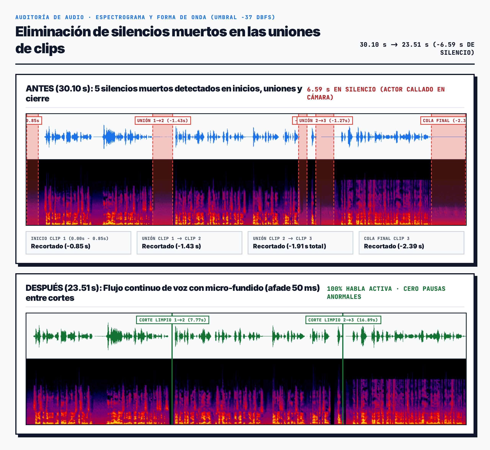
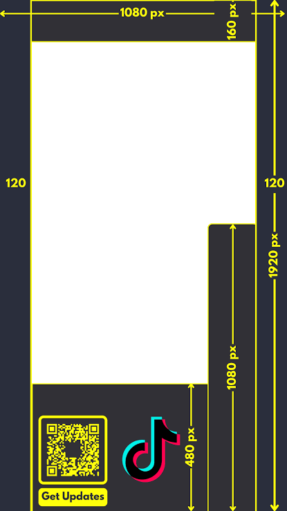
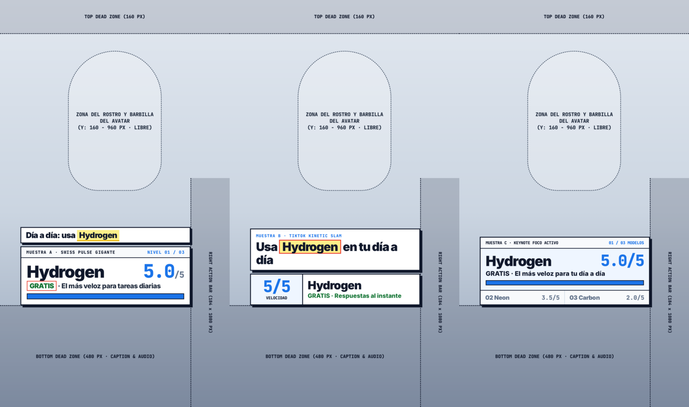

# Metodología de Video Vertical (`1080 × 1920 px` · Google Flow `@Yo` + Whisper + Espectrograma + OpenDesign Motion)

Esta guía explica paso a paso cómo producir reels y videos verticales de ~30 segundos (`9:16`, `1080 × 1920 px`) con tu Avatar entrenado en **Google Flow**, eliminando silencios anormales en las uniones mediante análisis de **espectrograma** y superponiendo **motion graphics gigantes Mobile-First** de **OpenDesign** dentro de los **Safe Margins** de TikTok, Instagram Reels y YouTube Shorts.

---

## 1. Diagrama de Flujo End-to-End de Producción de Video Vertical

```mermaid
flowchart TD
    A["Fuente / Tema + Guion Dividido en 3 Bloques de 10 s (0-10s, 10-20s, 20-30s)"] --> B["Abrir Google Flow (/browser + plugin antigravity-flow) en Modo Manual (Agente OFF)"]
    B --> C["Configurar: Video · Ingredientes (NO Fotogramas) · 9:16 · Omni 1.2 Flash · 720p · 10 s · x1"]
    C --> D["Clip 1 (00-10s): Adjuntar Avatar @Yo (Avatares) + Foto de Referencia + Bloque DON'Ts Anatómicos"]
    D --> E["Descargar Clip 1 (720p) y Extraer Último Fotograma Real (ffmpeg -sseof -0.15 -> clip1_last.png)"]
    E --> F["Clip 2 (10-20s): Adjuntar Avatar @Yo + clip1_last.png + Bloque DON'Ts Anatómicos"]
    F --> G["Descargar Clip 2 (720p) y Extraer Último Fotograma Real (ffmpeg -sseof -0.15 -> clip2_last.png)"]
    G --> H["Clip 3 (20-30s): Adjuntar Avatar @Yo + clip2_last.png + Bloque DON'Ts Anatómicos"]
    H --> I["Auditoría de Audio: faster-whisper (word_timestamps) + Análisis RMS (-37 dBFS) y Espectrograma"]
    I --> J["Recortar Silencios Muertos en Inicios, Uniones y Cola + Micro-fundido afade (50 ms)"]
    J --> K["CHECKPOINT OBLIGATORIO: Generar Lámina de Espectrograma (Antes/Después) + 3 Muestras Estáticas (A, B, C)"]
    K --> L{"Usuario elige Muestra (ej. Muestra B TikTok Kinetic Slam)"}
    L --> M["Renderizar Keyframes Transparentes 1080x1920 px en Safe Margins + Overlay en FFmpeg (Lanczos)"]
    M --> N["QC Visual de Mosaico de Escenas (read_file) -> Entrega del MP4 Final + Descripciones para IG y TikTok"]
```



---

## 2. Cómo Usar tu Avatar Real en Google Flow (Modo `Ingredientes`)

Un error común en Google Flow es elegir el modo `Fotogramas` (`Frames`) y subir una imagen estática: eso anima la foto con una voz sintética genérica y **no usa tu Avatar entrenado**.

1. **Selecciona siempre `Tipo de video: Ingredientes` (`Ingredients`):**
   - Escribe **`@`** en la caja de prompt o haz clic en el botón **`+`** (`Agregar ingredientes al cuadro de instrucción`) y abre la pestaña **`Avatares`**.
   - Selecciona tu Avatar (por ejemplo **`Yo`**). Esto adjunta el chip del Avatar (que contiene tu rostro y tu voz real entrenada) e inserta la etiqueta **`[Yo]`** dentro del prompt.
2. **Combina tu Avatar `@Yo` con una Foto de Referencia y Encadena el Último Fotograma:**
   - **En el Clip 1:** Adjunta simultáneamente tu Avatar **`[Yo]`** y una foto de referencia real (`daniel_ref.jpg`) para fijar iluminación, vestimenta, escenario (ej. terraza al aire libre) y proporciones faciales exactas.
   - **Extracción del último frame para continuidad:** Al descargar el Clip 1, extrae el último fotograma de video con `-sseof -0.15` (la pista de audio AAC suele durar ~30 ms más que la pista de video H.264, por lo que `-sseof -0.05` puede devolver un archivo vacío):
     ```bash
     ffmpeg -y -sseof -0.15 -i clip1.mp4 -frames:v 1 clip1_last.png
     ```
   - **En el Clip 2 y Clip 3:** Mantén adjunto **`[Yo]`** (para que la voz siga siendo idéntica) y reemplaza la foto adjunta por `clip1_last.png` (en el Clip 2) y `clip2_last.png` (en el Clip 3).
3. **Bloque Obligatorio de `DON'Ts` Anatómicos en Cada Prompt:**
   Para evitar que el modelo distorsione o agrande la nariz o las facciones al animar el habla, agrega siempre al final del prompt:
   ```text
   DON'Ts / Evitar estrictamente: NO hacer la nariz grande, ancha ni bulbosa, NO exagerar rasgos faciales, mantener exactamente las proporciones faciales y nariz fina, recta y pequeña de la foto de referencia adjunta, sin música de fondo, sin subtítulos ni texto en pantalla.
   ```

---

## 3. Análisis de Espectrograma y Eliminación de Silencios en las Uniones (`-37.0 dBFS`)

Cuando Google Flow genera un clip de 10 segundos, suele dejar entre `0.8 s` y `2.5 s` de silencio al inicio o al final. Si pegas los 3 clips crudos de 10 segundos, el avatar se queda callado mirando a cámara entre el Clip 1 y el Clip 2, y entre el Clip 2 y el Clip 3.



### Cómo lo resuelve el script `analyze_and_trim_silences.py`
1. Analiza la pista de audio en ventanas de `50 ms` calculando la energía RMS en `dBFS`.
2. Con el umbral `-37.0 dBFS` (más las marcas de tiempo por palabra de `faster-whisper`), recorta:
   - El silencio muerto antes de la primera palabra del Clip 1.
   - Los silencios muertos en las uniones `Clip 1 -> Clip 2` y `Clip 2 -> Clip 3`.
   - Pausas internas anormales (`>= 0.65 s`).
   - La cola en silencio al final del Clip 3.
3. Une los segmentos activos aplicando un micro-fundido (`afade` de `50 ms`) en cada corte y escalando el video a `1080 × 1920 px` (`lanczos`):
   ```bash
   python3 ~/.agents/skills/vertical-video-flow-opendesign/scripts/analyze_and_trim_silences.py \
     clip1.mp4 clip2.mp4 clip3.mp4 \
     -o avatar_trimmed_1080x1920.mp4
   ```

---

## 4. Geometría Estricta de Safe Margins (`1080 × 1920 px`)

Todo gráfico o subtítulo debe respetar las zonas donde TikTok, Instagram Reels y YouTube Shorts superponen sus botones e información:



- **Top Dead Zone (`0` a `160 px`):** Libre de elementos.
- **Zona del Rostro y Barbilla del Avatar (`160` a `1020 px`):** Nunca cubrir la cara ni la barbilla con tarjetas.
- **Right Action Bar (`184 px` de ancho × `1080 px` de alto desde abajo):** Deja libre toda la columna derecha donde aparecen los botones de perfil, Like, Comentarios, Guardados, Compartir y disco de audio.
- **Bottom Dead Zone (`480 px` inferiores, `y: 1440..1920 px`):** Deja libre la parte inferior donde aparecen el nombre de usuario, la descripción, el audio y las etiquetas.
- **Left Safe Margin (`96` a `120 px`):** Evita recortes en pantallas móviles estrechas.
- **Ventana Segura Exacta para Tarjetas (`Chest Safe Window`):** `left: 96px`, `right: 184px` (`ancho = 800 px`), `bottom: 480px` (`y <= 1440 px`), `top >= 1030 px`.

---

## 5. Motion Graphics Mobile-First de OpenDesign (`54px` a `88px`)

En un teléfono celular, las tablas con letra pequeña (`11px–22px`) no se alcanzan a leer. Basándonos en los 4 repositorios de motion de OpenDesign (`heygen-com/hyperframes`, `alchaincyf/huashu-art-motion`, `yangxu128/Motion.Lab` y `remotion-dev/remotion`), el sistema ofrece **3 variantes Mobile-First** dentro de la ventana segura:



1. **Muestra A (`Swiss Pulse · Giant Single-Focus`):** Regla *"Una pantalla, una sola cosa"* de `huashu-art-motion`. Cada modelo o concepto toma toda la tarjeta en el segundo en que se pronuncia, con título en **`78px`**, número en **`88px`** (`JetBrains Mono`) y barra de progreso gruesa (`28px`).
2. **Muestra B (`TikTok Kinetic Slam`):** Subtítulo cinético gigante arriba (**`56px`**) con palabra clave animada con efecto `slam` (recuadro rojo `Sketchout` + fondo amarillo `#FEF08A`), y tarjeta inferior dividida en bloque numérico gigante (**`76px`**) a la izquierda y título (**`54px`**) + barra animada a la derecha.
3. **Muestra C (`Keynote Step-Focus`):** El nivel activo que se pronuncia se expande a tamaño gigante (**`66px` / `74px`**) mientras los otros dos niveles quedan debajo en una tira compacta de contexto (**`28px`** en gris `#64748B`).
